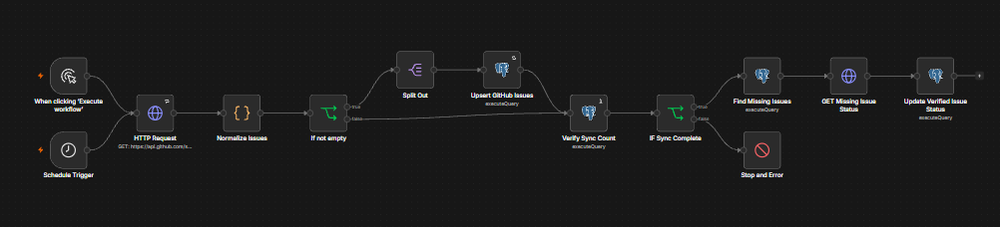
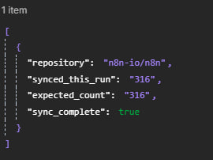
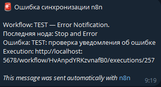

# GitHub Issues Sync — n8n + PostgreSQL

A self-hosted automation project that synchronizes open GitHub issues into PostgreSQL using n8n.

The project demonstrates practical API integration, pagination, JavaScript data transformation, PostgreSQL upserts, data integrity validation, synchronization tracking, and error handling.

## Project Overview

The workflow retrieves open issues from the public [`n8n-io/n8n`](https://github.com/n8n-io/n8n) repository using the GitHub REST API and synchronizes them with a PostgreSQL database.

It supports both manual execution and scheduled daily synchronization.

In addition to importing currently open issues, the workflow identifies previously open issues that are missing from the latest complete result set. It retrieves their current status directly from GitHub before updating the database.

This prevents the workflow from assuming that an issue has been closed merely because it is absent from the search results.

## Architecture

### Main Workflow

```text
Manual Trigger ───────┐
                      ├──> HTTP Request (GitHub API)
Schedule Trigger ─────┘              |
                                     v
                              Normalize Issues
                                     |
                                     v
                         IF: issue_count > 0?
                              /           \
                           True           False
                            |               |
                            v               |
                         Split Out         |
                            |               |
                            v               |
                     PostgreSQL Upsert     |
                            |               |
                            └───────┬───────┘
                                    v
                            Verify Sync Count
                                    |
                                    v
                           IF Sync Complete?
                              /          \
                           True          False
                            |              |
                            v              v
                     Find Missing      Stop And Error
                        Issues
                            |
                            v
                  GET Missing Issue Status
                            |
                            v
                 Update Verified Issue Status
```

### Error Handling Workflow

```text
Error Trigger
     |
     v
Telegram Send Message
```

The main workflow is configured to use the separate Error Handling workflow through n8n workflow settings.

## Key Features

- **GitHub REST API integration:** Retrieves public issues from a specified repository.
- **Pagination:** Fetches up to 100 results per page and combines the returned pages.
- **Data normalization:** Transforms API responses into structured records using JavaScript.
- **Completeness validation:** Checks response structure, incomplete search results, consistency of `total_count` between pages, and the actual number of retrieved issues.
- **Empty result handling:** Keeps the workflow running even when GitHub returns zero issues. Database synchronization verification and missing-issue reconciliation can still proceed.
- **Idempotent database writes:** Uses PostgreSQL `INSERT ... ON CONFLICT DO UPDATE` to avoid duplicate records.
- **Synchronization tracking:** Associates records with the current n8n execution using `sync_run_id`.
- **Sync verification:** Compares the number of records written to PostgreSQL with the expected number returned by GitHub.
- **Missing issue reconciliation:** Finds previously open issues absent from the current result set and retrieves their actual status before updating the database.
- **Error handling:** Uses `Stop And Error` when synchronization verification fails, allowing the configured Error Workflow to handle the failure.
- **Retry configuration:** Enables retry attempts for selected HTTP Request and PostgreSQL operations.
- **Telegram notifications:** Sends workflow error notifications through a separate Error Handling workflow.
- **Scheduled execution:** Supports daily synchronization and manual runs.

## Data Model

The PostgreSQL table is named `github_issues_sync`.

The table schema is provided in [`schema.sql`](schema.sql).

| Column | Purpose |
|---|---|
| `repository` | GitHub repository identifier |
| `github_id` | Unique GitHub issue identifier |
| `issue_number` | Issue number within the repository |
| `title` | Issue title |
| `state` | Current issue state |
| `author_login` | GitHub username of the author |
| `created_at` | Issue creation timestamp |
| `updated_at` | Last update timestamp reported by GitHub |
| `closed_at` | Issue closing timestamp, when applicable |
| `html_url` | Link to the original GitHub issue |
| `comments_count` | Number of comments |
| `locked` | Whether the issue is locked |
| `labels` | JSONB array containing label names |
| `body` | Issue description |
| `sync_run_id` | n8n execution identifier |
| `last_synced_at` | Last synchronization timestamp |

Database integrity is maintained through:

- Composite primary key: `(repository, github_id)`.
- Unique constraint: `(repository, issue_number)`.
- Parameterized SQL queries for database operations.

## Synchronization Logic

1. Manual or scheduled execution starts the workflow.
2. HTTP Request retrieves open issues from GitHub Search API.
3. Pagination collects all available result pages.
4. `Normalize Issues` validates the response and creates a structured result containing `issue_count` and an `issues` array.
5. An IF node checks whether the result contains issues:
   - If issues exist, `Split Out` converts the array into individual n8n items and PostgreSQL Upsert processes them.
   - If no issues exist, the database write operation is skipped.
6. Both paths continue to `Verify Sync Count`.
7. The workflow compares the number of records synchronized during the current execution with GitHub's expected result count.
8. If the counts match, the workflow continues to missing-issue reconciliation.
9. If the counts do not match, `Stop And Error` raises an execution error.
10. Previously open issues missing from the current complete result set are retrieved individually from GitHub and their actual status is saved in PostgreSQL.

A missing issue is never automatically marked as closed without verification through the GitHub API.

## Error Handling

The main workflow uses n8n's Error Workflow functionality.

The separate Error Handling workflow receives execution errors through an Error Trigger and sends a Telegram notification containing available execution information, such as:

- Workflow name
- Last executed node
- Error message
- Execution URL

A failed synchronization count is explicitly converted into a workflow error using `Stop And Error`.

## Testing and Validation

The following scenarios have been checked during development:

- **Regular synchronization:** Retrieved and processed 327 issues. PostgreSQL verification returned `synced_this_run = 327`, `expected_count = 327`, and `sync_complete = true`.
- **Empty result handling:** Verified that `Normalize Issues` produces a single container item with `issue_count = 0` and an empty `issues` array. Confirmed that the IF node routes this result through its False output.
- **Incomplete synchronization handling:** Simulated a mismatch between 327 expected issues and 326 synchronized records. Confirmed that the IF node routes the result to `Stop And Error` and that the error message contains the expected and actual counts.
- **Data normalization:** Verified the normalized issue structure, including repository information, identifiers, timestamps, labels, and issue description.

The zero-issue scenario was tested at the data transformation and IF-routing level. A full end-to-end reconciliation run with an empty result set has not yet been performed.

## Technology Stack

- n8n — workflow orchestration
- GitHub REST API — issue retrieval
- PostgreSQL — persistent data storage
- SQL — data modeling, parameterized queries, and upserts
- JavaScript — pagination aggregation and data transformation
- Telegram — error notifications
- Docker — self-hosted environment

## Setup

### 1. Infrastructure

Run n8n and PostgreSQL in your environment.

### 2. Database

Execute [`schema.sql`](schema.sql) in your PostgreSQL database to create the required table, constraints, and indexes.

### 3. n8n Credentials

Configure PostgreSQL credentials in n8n.

Configure Telegram credentials for the Error Handling workflow.

### 4. Import Workflows

Import the following JSON exports:

- `API Sync — GitHub Issues.json`
- `API Sync — Error Handler.json`

Reassign the required credentials after importing.

### 5. Configure Error Notifications

In the Error Handling workflow, replace `YOUR_TELEGRAM_CHAT_ID` with your own Telegram chat ID.

Select your Telegram credentials and verify the Error Workflow assignment in the main workflow settings.

### 6. Execute

Run the main workflow manually and verify the synchronization count.

Activate the workflow to enable scheduled daily execution.

## Limitations and Future Improvements

- GitHub Search API limits the number of results available through one search query. The workflow validates the returned count rather than silently accepting an incomplete result set.
- The current implementation uses unauthenticated requests to access public GitHub data. API rate limits therefore apply.
- Retry policies use configured retry attempts and fixed wait intervals. Dynamic handling of `Retry-After` and rate-limit reset headers is not implemented.
- A dedicated synchronization run history table and automated integration tests could be added in a future production-oriented version.
- A full end-to-end test of the empty-result reconciliation scenario remains outstanding.

## Skills Demonstrated

REST API integration, pagination, JavaScript data transformation, JSON processing, PostgreSQL, SQL data modeling, idempotent writes, synchronization tracking, data integrity validation, error handling, and n8n workflow orchestration.

## Screenshots

### Main Workflow Architecture



### PostgreSQL Synchronization Results



### Telegram Error Notification


