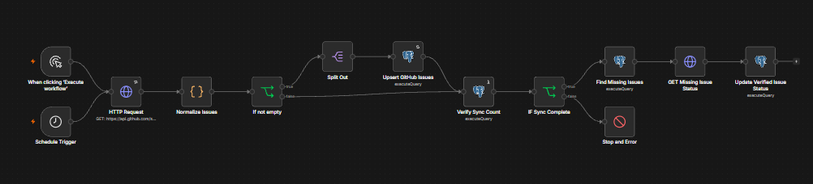
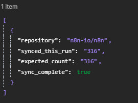
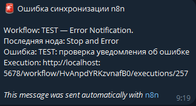

# GitHub Issues Sync — n8n + PostgreSQL

Проект автоматизации на базе n8n для синхронизации открытых GitHub Issues с базой данных PostgreSQL.

Проект демонстрирует практические навыки интеграции с REST API, работы с пагинацией, преобразования данных на JavaScript, идемпотентной записи в базу данных, проверки целостности данных и обработки ошибок.

## О проекте

Workflow получает открытые Issues из публичного репозитория [`n8n-io/n8n`](https://github.com/n8n-io/n8n) через GitHub REST API и синхронизирует их с PostgreSQL.

Поддерживаются ручной запуск и ежедневная автоматическая синхронизация.

Помимо импорта текущих открытых Issues, workflow обнаруживает ранее открытые задачи, отсутствующие в последней полной выборке. Перед обновлением базы он отдельно запрашивает актуальный статус каждой такой задачи у GitHub.

Таким образом, отсутствие Issue в поисковой выдаче не считается достаточным основанием для автоматического закрытия записи в базе данных.

## Архитектура

### Основной Workflow

```text
Manual Trigger ───────┐
                      ├──> HTTP Request (GitHub API)
Schedule Trigger ─────┘              |
                                     v
                              Normalize Issues
                                     |
                                     v
                         IF: issue_count > 0?
                              /           \
                           True           False
                            |               |
                            v               |
                         Split Out         |
                            |               |
                            v               |
                     PostgreSQL Upsert     |
                            |               |
                            └───────┬───────┘
                                    v
                            Verify Sync Count
                                    |
                                    v
                           IF Sync Complete?
                              /          \
                           True          False
                            |              |
                            v              v
                     Find Missing      Stop And Error
                        Issues
                            |
                            v
                  GET Missing Issue Status
                            |
                            v
                 Update Verified Issue Status
```

### Workflow обработки ошибок

```text
Error Trigger
     |
     v
Telegram Send Message
```

Основной workflow использует отдельный Error Handling Workflow, назначенный в настройках n8n.

## Основные возможности

- **Интеграция с GitHub REST API:** получение открытых Issues из выбранного репозитория.
- **Пагинация:** загрузка до 100 результатов на страницу с последующим объединением страниц.
- **Нормализация данных:** преобразование API-ответов в структурированные записи с помощью JavaScript.
- **Проверка полноты выборки:** проверка структуры ответа, признака `incomplete_results`, согласованности `total_count` между страницами и фактического количества полученных Issues.
- **Обработка пустой выборки:** workflow продолжает выполнение даже при отсутствии открытых Issues. Проверка синхронизации и поиск ранее открытых задач могут выполняться без попытки записать пустой массив в PostgreSQL.
- **Идемпотентная запись:** использование PostgreSQL `INSERT ... ON CONFLICT DO UPDATE` для обновления существующих записей без создания дубликатов.
- **Отслеживание запусков:** привязка записей к конкретному выполнению n8n через `sync_run_id`.
- **Проверка синхронизации:** сравнение количества записанных записей с ожидаемым количеством из GitHub.
- **Поиск пропущенных Issues:** обнаружение ранее открытых задач, отсутствующих в текущей выборке, и получение их фактического статуса через GitHub API.
- **Обработка ошибок:** использование `Stop And Error` при неуспешной проверке синхронизации с передачей ошибки в настроенный Error Workflow.
- **Повторные попытки:** настроенные retry-механизмы для отдельных HTTP Request и PostgreSQL операций.
- **Telegram-уведомления:** отправка сообщений об ошибках через отдельный workflow.
- **Автоматический запуск:** ежедневная синхронизация наряду с ручным запуском.

## Структура базы данных

Основная таблица PostgreSQL называется `github_issues_sync`.

Полная SQL-схема находится в файле [`schema.sql`](schema.sql).

| Колонка | Назначение |
|---|---|
| `repository` | Идентификатор репозитория |
| `github_id` | Уникальный идентификатор Issue в GitHub |
| `issue_number` | Номер Issue внутри репозитория |
| `title` | Заголовок Issue |
| `state` | Текущий статус Issue |
| `author_login` | Имя пользователя, создавшего Issue |
| `created_at` | Дата создания |
| `updated_at` | Время последнего изменения по данным GitHub |
| `closed_at` | Дата закрытия, если применимо |
| `html_url` | Ссылка на оригинальную Issue |
| `comments_count` | Количество комментариев |
| `locked` | Признак блокировки обсуждения |
| `labels` | Массив меток в формате JSONB |
| `body` | Описание Issue |
| `sync_run_id` | Идентификатор выполнения n8n |
| `last_synced_at` | Время последней синхронизации |

Целостность данных обеспечивается следующими ограничениями:

- Составной первичный ключ `(repository, github_id)`.
- Уникальное ограничение `(repository, issue_number)`.
- Параметризованные SQL-запросы для операций с базой данных.

## Логика синхронизации

1. Ручной или автоматический запуск инициирует workflow.
2. HTTP Request получает открытые Issues через GitHub Search API.
3. Пагинация собирает все доступные страницы результатов.
4. `Normalize Issues` проверяет ответ API и формирует структурированный результат с полями `issue_count` и `issues`.
5. IF проверяет, есть ли найденные задачи:
   - Если задачи есть, `Split Out` разделяет массив на отдельные n8n items, после чего PostgreSQL Upsert записывает их в базу.
   - Если задач нет, запись в PostgreSQL пропускается.
6. Обе ветки продолжаются узлом `Verify Sync Count`.
7. Workflow сравнивает количество записей текущего запуска с ожидаемым количеством из GitHub.
8. Если количество совпадает, workflow переходит к поиску пропущенных задач.
9. Если количество не совпадает, `Stop And Error` создаёт ошибку выполнения.
10. Ранее открытые Issues, отсутствующие в текущей полной выборке, запрашиваются непосредственно через GitHub API. Их фактический статус сохраняется в PostgreSQL.

Отсутствующая Issue не переводится в статус `closed` без проверки через GitHub API.

## Обработка ошибок

Основной workflow использует функциональность Error Workflow в n8n.

Отдельный Error Handling Workflow получает ошибки через Error Trigger и отправляет Telegram-уведомление с доступной информацией о выполнении:

- Название workflow.
- Последний выполненный узел.
- Текст ошибки.
- Ссылка на выполнение.

Несоответствие количества записей ожидаемому результату явно преобразуется в ошибку через `Stop And Error`.

## Тестирование и проверка

В ходе разработки были проверены следующие сценарии:

- **Обычная синхронизация:** получено и обработано 327 Issues. Проверка PostgreSQL вернула `synced_this_run = 327`, `expected_count = 327`, `sync_complete = true`.
- **Обработка пустого результата:** проверено, что `Normalize Issues` возвращает один item с `issue_count = 0` и пустым массивом `issues`. Также проверена маршрутизация через выход False узла IF.
- **Обработка неполной синхронизации:** смоделировано расхождение между ожидаемыми 327 и фактически записанными 326 записями. Проверено направление выполнения в `Stop And Error` и формирование сообщения с ожидаемым и фактическим количеством.
- **Нормализация данных:** проверена структура подготовленных Issues, включая сведения о репозитории, идентификаторы, даты, метки и описание задачи.

Сценарий с нулём Issues проверен на уровне структуры данных и маршрутизации IF. Полный сквозной запуск сверки базы при пустой выборке пока не выполнялся.

## Используемые технологии

- n8n — оркестрация workflow.
- GitHub REST API — получение Issues.
- PostgreSQL — хранение данных.
- SQL — моделирование таблиц, параметризованные запросы и UPSERT.
- JavaScript — обработка пагинации и преобразование данных.
- Telegram — уведомления об ошибках.
- Docker — self-hosted окружение.

## Установка и настройка

### 1. Подготовка инфраструктуры

Разверните n8n и PostgreSQL в своём окружении.

### 2. Создание таблицы

Выполните SQL из [`schema.sql`](schema.sql) в PostgreSQL. Файл создаёт необходимую таблицу, ограничения и индексы.

### 3. Настройка Credentials

Настройте PostgreSQL Credentials в n8n.

Для Error Handling Workflow настройте Telegram Credentials.

### 4. Импорт workflow

Импортируйте JSON-файлы:

- `API Sync — GitHub Issues.json`
- `API Sync — Error Handler.json`

После импорта назначьте необходимые Credentials.

### 5. Настройка уведомлений

В Error Handling Workflow замените `YOUR_TELEGRAM_CHAT_ID` на собственный Telegram Chat ID.

Выберите соответствующие Telegram Credentials и проверьте назначение Error Workflow в настройках основного workflow.

### 6. Запуск

Выполните основной workflow вручную и проверьте результат синхронизации.

Для ежедневного автоматического запуска активируйте workflow.

## Ограничения и возможные улучшения

- GitHub Search API ограничивает максимальное количество результатов для одного поискового запроса. Workflow проверяет полноту полученных данных, а не принимает частичную выборку как успешную.
- Текущая реализация использует запросы без авторизации для получения публичных данных GitHub. Поэтому применяются ограничения API для неавторизованных запросов.
- Повторные попытки используют настроенное количество попыток и фиксированные интервалы ожидания. Динамическая обработка `Retry-After` и заголовков сброса лимита пока не реализована.
- В дальнейшем можно добавить отдельную таблицу истории запусков синхронизации и автоматические интеграционные тесты.
- Полный сквозной тест сверки при нулевом количестве Issues пока не выполнялся.

## Продемонстрированные навыки

Интеграция REST API, пагинация, преобразование данных на JavaScript, обработка JSON, PostgreSQL, проектирование SQL-схем, идемпотентная запись, отслеживание синхронизации, проверка целостности данных, обработка ошибок и построение автоматизаций в n8n.

## Скриншоты

### Архитектура основного Workflow



### Результаты синхронизации PostgreSQL



### Telegram-уведомление об ошибке


